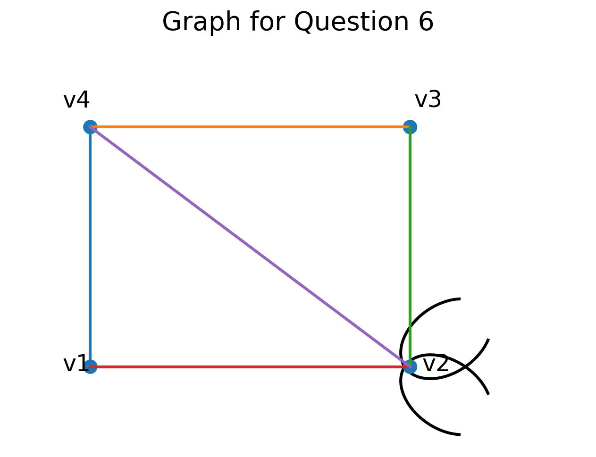

# COLLEGE OF INFORMATION TECHNOLOGY & ENGINEERING

**2026**  
**Bachelor of Information Technology: Second Semester Pre-Board**  
**Course**: Discrete Structure  
**Time**: 03:00 hours  
**Full Marks**: 80  
**Pass Marks**: 32

---

*Candidates are required to give their answers in their own words as far as practicable. Figures in the margin indicate full marks.*

---

## Group A

**Attempt any two questions:** **[2 × 12 = 24]**

1. Define Tautology, Contradiction, and Contingency with truth tables and examples. Construct the truth table for $((p \lor q) \land \neg p) \rightarrow q$. What is Propositional Logic and Propositions? **[5+5+2]**

2. What is mathematical induction? By mathematical induction, show that 
   $$1^2 + 2^2 + 3^2 + \dots + n^2 = \frac{n(n+1)(2n+1)}{6}$$ **[2+10]**

3. 
   a. Differentiate between DFA and NFA. Design a DFA that accepts all strings having an even number of $a$'s and an odd number of $b$'s. **[2+4]**  
   b. Design a DFA over binary digits that accept:  
      i. Binary strings divisible by 3. **[3]**  
      ii. Binary strings containing the substring $101$. **[3]**

---

## Group B

**Answer any SEVEN questions.** **[7 × 8 = 56]**

1. Discuss the Basic Principle of Counting. A password consists of 1 uppercase letter followed by 6 digits. How many passwords can be formed if repetition is allowed? **[2+6]**

2. State the Pigeonhole Principle. Show that among any 8 integers, there exist two integers having the same remainder when divided by 7. **[2+6]**

3. Use Warshall's algorithm to find the transitive closure of the relation $R = \{(1,2), (1,3), (1,4), (2,3), (2,4), (3,4)\}$. **[8]**

4. What is a Relation? Explain the properties of relations:
   a. Reflexive  
   b. Symmetric  
   c. Antisymmetric  
   d. Transitive  
   
   Give one example of each. **[1+7]**

5. Define a Linear Homogeneous Recurrence Relation. Solve $a_n = 5a_{n-1} - 6a_{n-2}$ with $a_0 = 3, a_1 = 9$. **[2+6]**

6. What is a graph? Find the degree of each vertex of the graph shown below. **[2+6]**

  

7. Out of 70 students, 40 are taking Java Programming, and 38 are taking Python Programming. If 18 students are taking both:  
   a. How many students are taking neither course?  
   b. How many students are taking either course?  
   c. What is the probability that a chosen student is taking only Python?  
   
   Draw the Venn diagram. **[2+2+2+2]**

8. Explain the Hasse Diagram for a relation. How can you construct a Hasse diagram for a relation? Explain with steps. Discuss LUB and GLB. **[2+4+2]**

---

# PURBANCHAL UNIVERSITY 2022

**Bachelor in Information Technology (B.I.T.) / Second Semester / Final**  
**Time:** 03:00 hrs.  
**Full Marks:** 80 / **Pass Marks:** 32  
**BIT153HS: Discrete Structure (New Course)**
**Semester / Year: 2nd Semester / 2022 (New Course)**

*Candidates are required to give their answers in their own words as far as practicable.*  
*Figures in the margin indicate full marks.*

---

## Group A

**Answer TWO questions.** **[2 × 12 = 24]**

1. (a) What is Logic? What are propositions? Differentiate between Tautology and Contradiction with examples. Draw a truth table for $(p \rightarrow q) \land (\sim q \rightarrow \sim (\sim p))$. **[2 + 4 + 6]**

2. What is mathematical induction? By mathematical induction, show that:
   $$1^2 + 2^2 + 3^2 + \dots + n^2 = \frac{n(n+1)(2n+1)}{6}$$ **[2 + 10]**

3. (a) Differentiate between deterministic finite automata and non-deterministic finite automata. **[6]**  
   (b) Design a DFA that accepts set of binary strings having odd number of zeros and odd number of ones. **[6]**

---

## Group B

**Answer SEVEN questions.** **[7 × 8 = 56]**

4. Discuss about basic principle of counting. Each user on a computer system has a password which is eight characters long, where each character is an uppercase letter or a digit. Each password must contain one digit followed by seven alphabets. How many passwords are possible when repetition is allowed? **[2 + 6]**

5. What is combination? In how many ways a committee of 7 people be formed, consisting of 4 men and 3 women from a group of 10 men and 8 women? **[2 + 6]**

6. Use Warshall's algorithm to find the transitive closure of the relation $R = \{(1,2), (1,3), (1,4), (2,3), (2,4), (3,4)\}$. **[8]**

7. State Pigeonhole principle. Show that if any eight positive integers are chosen, two of them will have the same remainder when divided by 7. **[2 + 6]**

8. What is graph? Find the degree of vertex of the graph. **[2 + 6]**

   > [Diagram Description]: A graph with four labeled vertices $v_1, v_2, v_3, v_4$. Vertices $v_1, v_2, v_3, v_4$ form a rectangular cycle with edges $(v_1, v_4)$, $(v_4, v_3)$, $(v_3, v_2)$, and $(v_2, v_1)$. There is a diagonal edge connecting $v_4$ and $v_2$, and two self-loops attached at vertex $v_2$.

9. Discuss union, intersection, and difference of two sets with example. **[8]**

10. What is relation? Discuss reflexive, symmetric and transitive relation with examples. **[2 + 6]**

11. Define recurrence relation. Find the solution of recurrence relation of $a_n = 5a_{n-1} - 6a_{n-2}$ with $a_0 = 5$ and $a_1 = 7$. **[2 + 6]**
