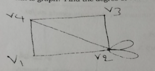
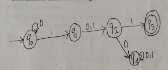
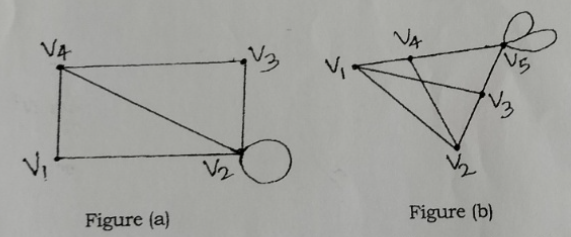
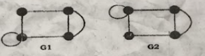

# COLLEGE OF INFORMATION TECHNOLOGY & ENGINEERING

**2026**  
**Bachelor of Information Technology: Second Semester Pre-Board**  
**Course**: Discrete Structure  
**Time**: 03:00 hours  
**Full Marks**: 80  
**Pass Marks**: 32

---

*Candidates are required to give their answers in their own words as far as practicable. Figures in the margin indicate full marks.*

---

## Group A

**Attempt any two questions:** **[2 × 12 = 24]**

1. Define Tautology, Contradiction, and Contingency with truth tables and examples. Construct the truth table for $((p \lor q) \land \neg p) \rightarrow q$. What is Propositional Logic and Propositions? **[5+5+2]**

2. What is mathematical induction? By mathematical induction, show that 
   $$1^2 + 2^2 + 3^2 + \dots + n^2 = \frac{n(n+1)(2n+1)}{6}$$ **[2+10]**

3. 
   a. Differentiate between DFA and NFA. Design a DFA that accepts all strings having an even number of $a$'s and an odd number of $b$'s. **[2+4]**  
   b. Design a DFA over binary digits that accept:  
      i. Binary strings divisible by 3. **[3]**  
      ii. Binary strings containing the substring $101$. **[3]**

---

## Group B

**Answer any SEVEN questions.** **[7 × 8 = 56]**

1. Discuss the Basic Principle of Counting. A password consists of 1 uppercase letter followed by 6 digits. How many passwords can be formed if repetition is allowed? **[2+6]**

2. State the Pigeonhole Principle. Show that among any 8 integers, there exist two integers having the same remainder when divided by 7. **[2+6]**

3. Use Warshall's algorithm to find the transitive closure of the relation $R = \{(1,2), (1,3), (1,4), (2,3), (2,4), (3,4)\}$. **[8]**

4. What is a Relation? Explain the properties of relations:
   a. Reflexive  
   b. Symmetric  
   c. Antisymmetric  
   d. Transitive  
   
   Give one example of each. **[1+7]**

5. Define a Linear Homogeneous Recurrence Relation. Solve $a_n = 5a_{n-1} - 6a_{n-2}$ with $a_0 = 3, a_1 = 9$. **[2+6]**

6. What is a graph? Find the degree of each vertex of the graph shown below. **[2+6]**

  

7. Out of 70 students, 40 are taking Java Programming, and 38 are taking Python Programming. If 18 students are taking both:  
   a. How many students are taking neither course?  
   b. How many students are taking either course?  
   c. What is the probability that a chosen student is taking only Python?  
   
   Draw the Venn diagram. **[2+2+2+2]**

8. Explain the Hasse Diagram for a relation. How can you construct a Hasse diagram for a relation? Explain with steps. Discuss LUB and GLB. **[2+4+2]**

---

# PURBANCHAL UNIVERSITY 2022

**Bachelor in Information Technology (B.I.T.) / Second Semester / Final**  
**Time:** 03:00 hrs.  
**Full Marks:** 80 / **Pass Marks:** 32  
**BIT153HS: Discrete Structure (New Course)**
**Semester / Year: 2nd Semester / 2022 (New Course)**

*Candidates are required to give their answers in their own words as far as practicable.*  
*Figures in the margin indicate full marks.*

---

## Group A

**Answer TWO questions.** **[2 × 12 = 24]**

1. (a) What is Logic? What are propositions? Differentiate between Tautology and Contradiction with examples. Draw a truth table for $(p \rightarrow q) \land (\sim q \rightarrow \sim (\sim p))$. **[2 + 4 + 6]**

2. What is mathematical induction? By mathematical induction, show that:
   $$1^2 + 2^2 + 3^2 + \dots + n^2 = \frac{n(n+1)(2n+1)}{6}$$ **[2 + 10]**

3. (a) Differentiate between deterministic finite automata and non-deterministic finite automata. **[6]**  
   (b) Design a DFA that accepts set of binary strings having odd number of zeros and odd number of ones. **[6]**

---

## Group B

**Answer SEVEN questions.** **[7 × 8 = 56]**

4. Discuss about basic principle of counting. Each user on a computer system has a password which is eight characters long, where each character is an uppercase letter or a digit. Each password must contain one digit followed by seven alphabets. How many passwords are possible when repetition is allowed? **[2 + 6]**

5. What is combination? In how many ways a committee of 7 people be formed, consisting of 4 men and 3 women from a group of 10 men and 8 women? **[2 + 6]**

6. Use Warshall's algorithm to find the transitive closure of the relation $R = \{(1,2), (1,3), (1,4), (2,3), (2,4), (3,4)\}$. **[8]**

7. State Pigeonhole principle. Show that if any eight positive integers are chosen, two of them will have the same remainder when divided by 7. **[2 + 6]**

8. What is graph? Find the degree of vertex of the graph. **[2 + 6]**

   

9. Discuss union, intersection, and difference of two sets with example. **[8]**

10. What is relation? Discuss reflexive, symmetric and transitive relation with examples. **[2 + 6]**

11. Define recurrence relation. Find the solution of recurrence relation of $a_n = 5a_{n-1} - 6a_{n-2}$ with $a_0 = 5$ and $a_1 = 7$. **[2 + 6]**

---

# PURBANCHAL UNIVERSITY 2023

**Bachelor in Information Technology (B.I.T.) / Second Semester / Final**  
**Time:** 03:00 hrs.  
**Full Marks:** 80 / **Pass Marks:** 32  
**BIT153HS: Discrete Structure (New Course)**
**Semester / Year: 2nd Semester / 2023 (New Course)**

*Candidates are required to give their answers in their own words as far as practicable.*

*Figure in the margin indicate full marks.*

## Group A

**Answer TWO questions.** **[2×12=24]**

1. (a) Find the converse, inverse, and contrapositive of the statement given below:
       If you study hard, you will pass the exam. **[3]**
   (b) Determine whether the compound statement given below is tautology or not. $(p \rightarrow \sim q) \leftrightarrow \sim (q \land r)$. **[5]**
   (c) State addition and multiplication laws of counting. **[4]**

2. Discuss reflexive, symmetric and transitive relation with example. If $R = \{(1, 2), (2, 3), (3, 1)\}$ and $A = \{1, 2, 3\}$, then find transitive closure of R using warshall's algorithm. **[6+6]**

3. (a) Define finite state automata. Draw the transition table for the deterministic finite automata given below. **[2+6]**
   
   

   (b) Define the following terms: **[4]**
       (i) Alphabet
       (ii) String
       (iii) Language
       (iv) Grammar

## Group B

**Answer SEVEN questions.** **[7×8=56]**

4. What do you understand by counting? In how many ways a committee of 7 people can be formed selecting 4 men and 3 women from a group of 8 men and 6 women? **[2+6]**

5. By mathematical induction, show that:
   
   $$1 + 2 + 3 + \dots + n = \frac{n(n+1)}{2}$$

6. What is recurrence relation? Solve the recurrence relation defined by $d_n = 2d_{n-1} - d_{n-2}$ with the initial conditions $d_1 = 1.5$ and $d_2 = 3$. **[1+7]**

7. Define POSET. Show that $\geq$ is a partial order on the set of integers, Z. **[2+6]**

8. Discuss Hamiltonian path and Hamiltonian circuit with examples.

9. Determine degree of each vertex of the graph: **[4+4]**

   

10. Define partition set and product set with examples. Discuss types of function. **[3+5]**

11. Write short notes on any TWO: **[4+4]**
    (a) Matrices
    (b) Pigeonhole principle
    (c) Minimum spanning tree

---

# PURBANCHAL UNIVERSITY 2024

**Bachelor in Information Technology (B.I.T.) / Second Semester / Final**  
**Time:** 03:00 hrs.  
**Full Marks:** 80 / **Pass Marks:** 32  
**BIT153HS: Discrete Structure (New Course)**
**Semester / Year: 2nd Semester / 2024 (New Course)**

*Candidates are required to give their answers in their own words as far as practicable. Figure in the margin indicate full marks.*

## Group A

**Answer TWO questions.** **[2×12=24]**

1. Define linear homogenous and non-homogeneous recurrence relation. Solve the recurrence relation $a_n = 2a_{n-1} + 5a_{n-2} - 6a_{n-3}$ for $n \geq 3$ with $a_0 = 7$, $a_1 = -4$ and $a_2 = 8$. **[4+8]**

2. Define Euler path and circuit. Determine if the following graphs are isomorphic or not. **[4+8]**

  
   

3. (a) Differentiate between DFA and NFA. Design DFA that accepts strings over input a and b which accepts strings having number of a divisible by 3 and number of b divisible by 2. **[2+4]**

   (b) Design DFA over input binary digits which accepts: **[3+3]**
   (i) Only those strings which is divisible by 5
   (ii) Only those strings containing substring 010

## Group B

**Answer SEVEN questions.** **[7×8=56]**

4. In a village of Bardiya district, 800 people speak Nepali or Tharu language. If 90% people speak Nepali and 20% speak Tharu language, use a Venn-diagram to find the following: [missing text]
   (a) The number of people who speak both languages.
   (b) The number of people who speak only Nepali language.

5. Suppose that the two lines in xy plane is related to one another by the relationship of "is parallel to". Show that the provided relation is an equivalence relation. [missing text]

6. What do you understand by mathematical induction? Prove that 
   $$1^2 + 2^2 + 3^2 + \dots + n^2 = \frac{n(n+1)(2n+1)}{6}$$ 
   using mathematical induction. [missing text]

7. Find the number of permutations of letters of the word "STATISTICS". In how many of these all three 'T's are together? How many of them begin with S? **[2+3+3]**

8. (a) Prove that a complete graph $K$ is $n-1$ regular. **[4]**
   
   (b) Prove that "there is one and only one path between any pair of vertices in a tree T." **[4]**

9. Check the validity of the argument: "If Today is Tuesday, I have test in Mathematics or Economics. If my Economics professor is sick, I will not have a test in Economics. Today is Tuesday and my Economics professor is sick. Thus, I have test in Mathematics." **[8]**

10. What is minimum spanning tree? Explain Prim's algorithm with your own example. **[2+6]**

11. Explain Hasse Diagram for a relation. How can you construct Hasse diagram for a relation? Explain with steps. Discuss LUB and GLB. **[2+3+3]**

---

# PURBANCHAL UNIVERSITY 2025

**Bachelor in Information Technology (B.I.T.) / Second Semester / Final**  
**Time:** 03:00 hrs.  
**Full Marks:** 80 / **Pass Marks:** 32  
**BIT153HS: Discrete Structure (New Course)**
**Semester / Year: 2nd Semester / 2025 (New Course)**

*Candidates are required to give their answers in their own words as far as practicable. Figure in the margin indicate full marks.*

## Group A

**Answer TWO questions. [2×12=24]**

1. Explain the concept of permutation and combination, providing detailed examples of how to apply them in solving counting problems, particularly those involving recurrence relations.

2. (a) Define finite state automata. Differentiate between deterministic finite automata and non-deterministic finite automata. **[2+4]**

   (b) Construct a DFA over $\Sigma = \{0,1\}$ whose language is set of string that ends with 111 and contains odd no of 1's. **[6]**

3. (a) What is transitive relation? Give an example of a relation that is transitive and one that is not. **[2+4]**

   

   (b) Explain the types of matrices: square, diagonal, identity and zero. Find $A^{-1}$ by adjoint method of $A = \begin{bmatrix} 4 & 3 \\ 3 & 2 \end{bmatrix}$.  **[2+4]**

## Group B

**Answer SEVEN questions. [7×8=56]**

 4. Consider the recurrence relation $a_n = 4a_{n-1} - 4a_{n-2}$. Find the general solution to the recurrence relation (beware the repeated root).

    (i) Find the solution when $a_0 = 1$ and $a_1 = 2$. **[4]**

    

    (ii) Find the solution when $a_0 = 1$ and $a_1 = 8$. **[4]**

 5. Explain pigeonhole principle and its applications. **[8]**

 6. What are the steps we need to follow to prove $P(n)$ is valid using induction? Follow the steps and prove, for $n \ge 1$ and $a \neq 1$, that

    $$
    1 + a + a^2 + \dots + a^n = \frac{a^{n+1} - 1}{a - 1}
    $$
    
  **[3+5]**
   

 8. Explain tautology, contradiction and contingency with example. Show that implication $(P \rightarrow Q)$ and contrapositive $(\neg Q \rightarrow \neg P)$ are equivalence. **[6+2]**

 9. How many different permutations can be formed from the letters of the word "MISSISSIPPI"? **[8]**

 10. List the types of function. Consider the function $f : R \rightarrow R$ defined by $f(x)=3x+2$. **[2+6]**

    (i) Show that f is bijective.

    (ii) Find the inverse function $f^{-1}(x)$

    (iii) Verify that $f(f^{-1}(x)) = x$ and $f^{-1}(f(x)) x$.

11. Define POSET. Show that $\ge$ is a partial order on the set of integer Z. **[8]**

12. What is a Binary Search Tree (BST)? Explain how elements are inserted into a BST with an example. Construct a BST using the values: 45, 20, 60, 15, 35, 50, 70. Then, perform in-order, pre-order, and post-order traversal on the tree. **[2+2+4]**
